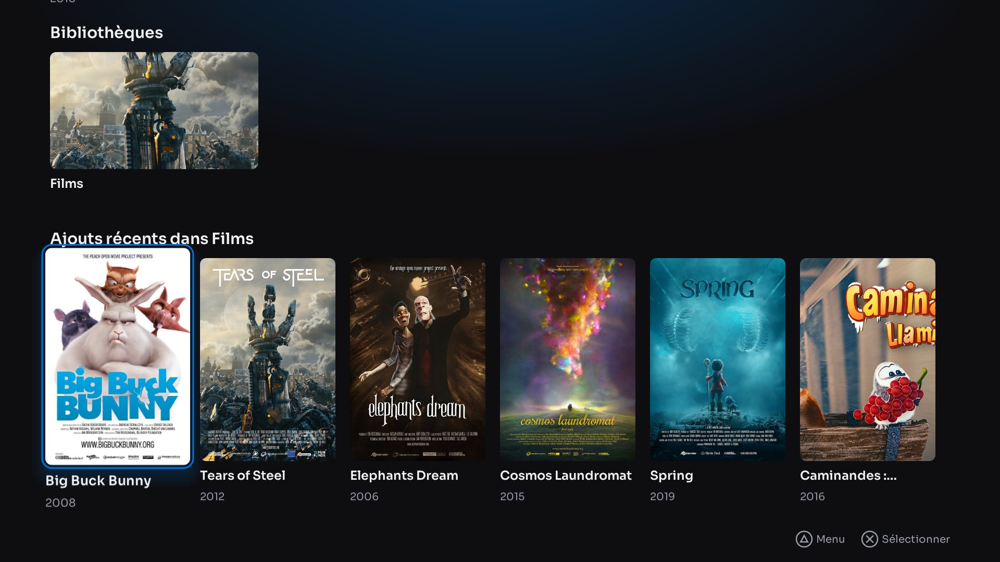
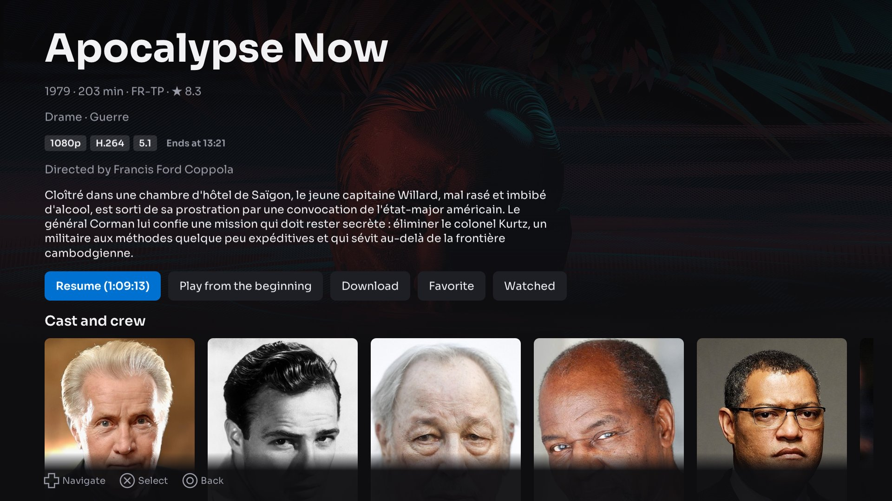
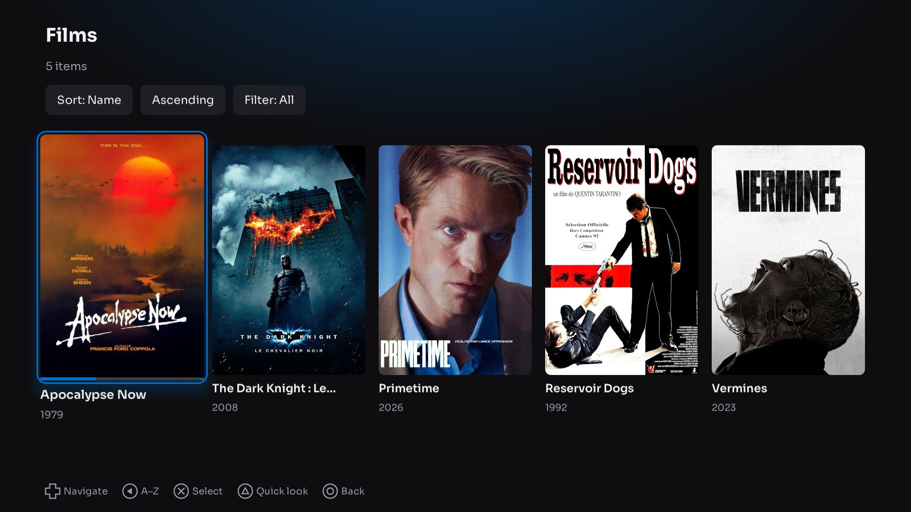
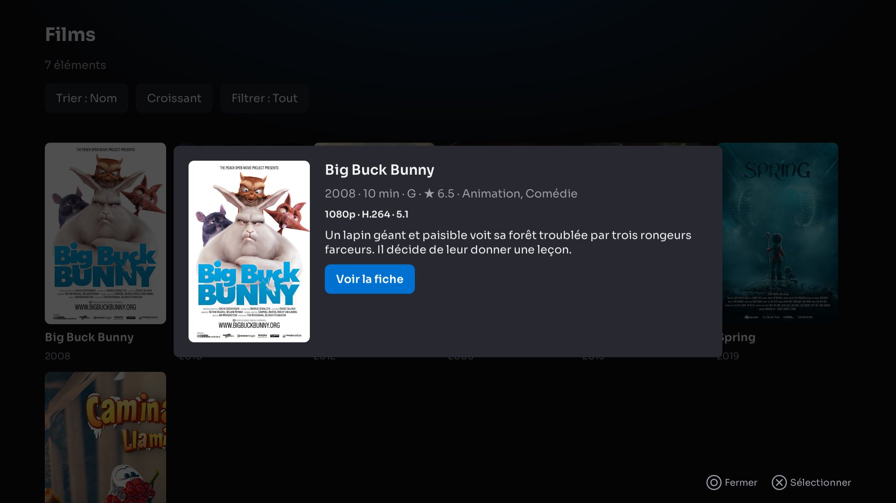
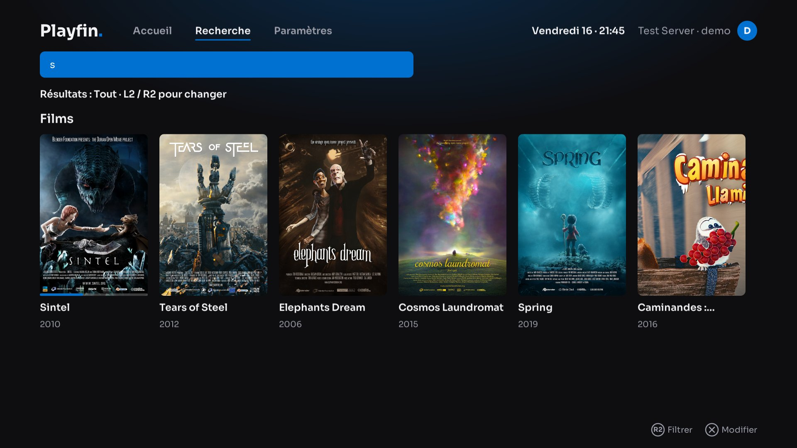
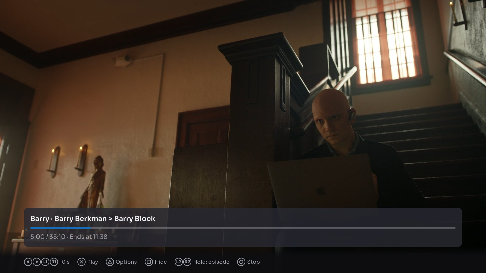
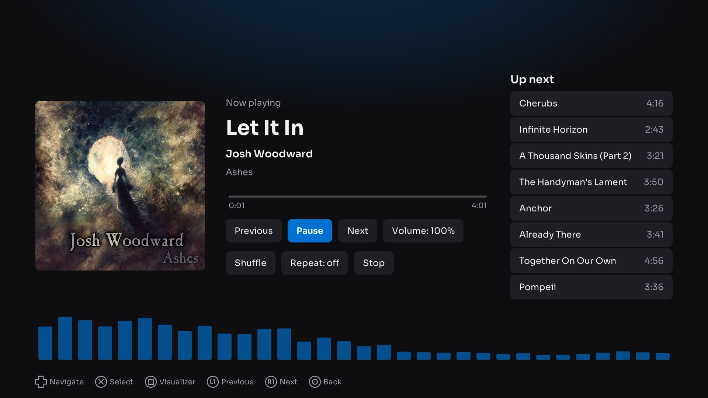
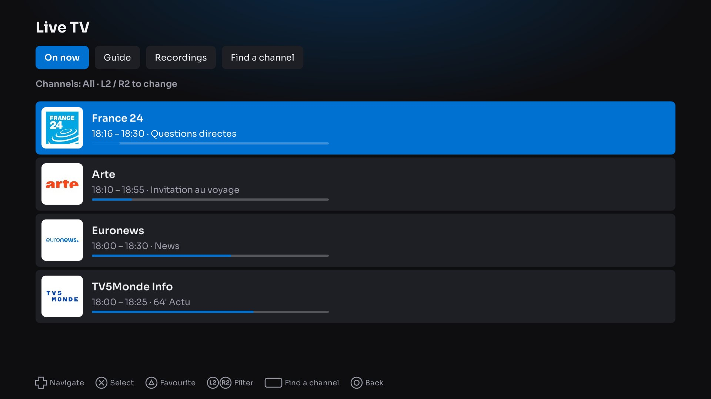
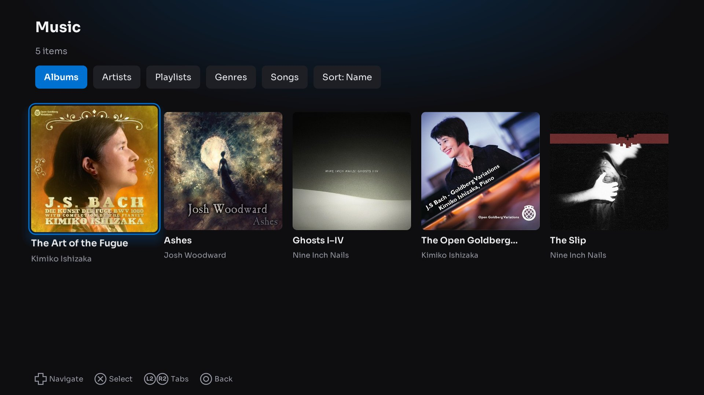

<h1 align="center">
  <picture>
    <source media="(prefers-color-scheme: dark)" srcset="docs/images/logo-on-dark.png">
    
  </picture>
</h1>

A Jellyfin client for the PlayStation 4, for consoles running homebrew (GoldHEN).

  
  
  
  
  

  

- **Direct play** of H.264, HEVC, VP9 and AV1 up to 1080p; the server transcodes the rest.
- **A home laid out as in Jellyfin**, a smooth interface made for the controller, its buttons shown on screen.
- **Series made easy:** resume, intro and credits skipping, the next episode at the end, subtitles in every script.
- **Downloads:** films, episodes and whole seasons kept on the console and played without the server.
- **Live TV:** channels on now, a programme guide, recordings, M3U channels and XMLTV guides.
- **Music:** a queue that keeps playing while you browse, with a visualizer.
- **For the whole household:** several servers and users, Quick Connect, a Jellyfin user per PS4 account,
  14 languages.
- **USB drives:** videos and music played straight from a USB drive, and downloads saved to it.
- **Updates in the app:** a new version is offered at the top of the settings and downloaded in one press.

| | |
|---|---|
|  |  |
|  |  |
|  |  |
|  |  |

## Requirements

- A PS4 with GoldHEN (the app is a homebrew package; the console's firmware and saves are not touched).
- A Jellyfin server, version 10.10 or later.

## Installing

1. Download `IV0001-PLFN00000_00-PLFN000000100000.pkg` with the button at the top, copy it to the console (USB
   drive or FTP) and install it from GoldHEN → Debug Settings → Package Installer.
2. Start Playfin from the home screen. Servers on your network are found automatically; others are added by
   address (for example `192.168.1.20:8096` or `https://media.example.com`).

The app keeps its settings in `/data/Playfin/` on the console (servers, settings, downloads, the image cache and
`playfin.log`). Updates: when a newer Playfin is out, a banner at the top of the settings downloads its package to
`/data/pkg` and checks it; install it from the Package Installer as above. USB drives are reached through
GoldHEN's FTP server, which must be on; Playfin writes on a drive only in a `Playfin` folder at its root.

## Building

Linux (development): `cmake --preset linux-debug && cmake --build --preset linux-debug`.
PS4 package: `scripts/build-ps4.sh` (Docker). Details in [docs/building.md](docs/building.md), tests in
[docs/testing.md](docs/testing.md), how the code is organised in [docs/architecture.md](docs/architecture.md),
security notes in [docs/security.md](docs/security.md).

## Licence and source

Playfin is free software under the GNU General Public License v3.0 (see [LICENSE](LICENSE)). It is built with
third-party components under their own licences, listed in [THIRD_PARTY_LICENSES](THIRD_PARTY_LICENSES).
